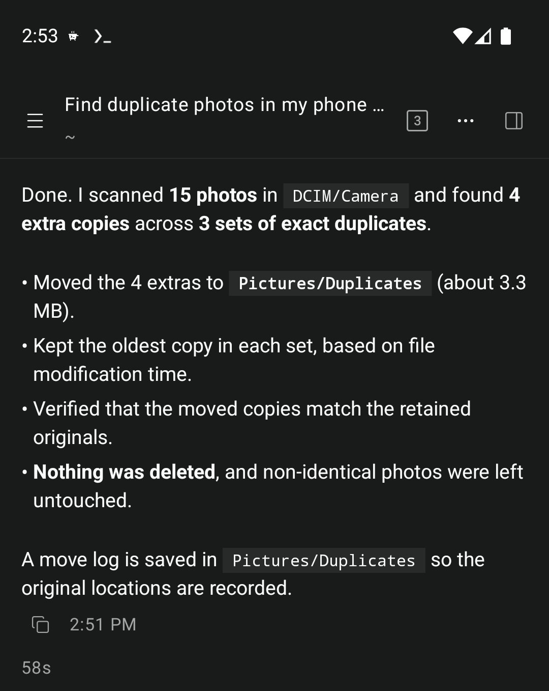
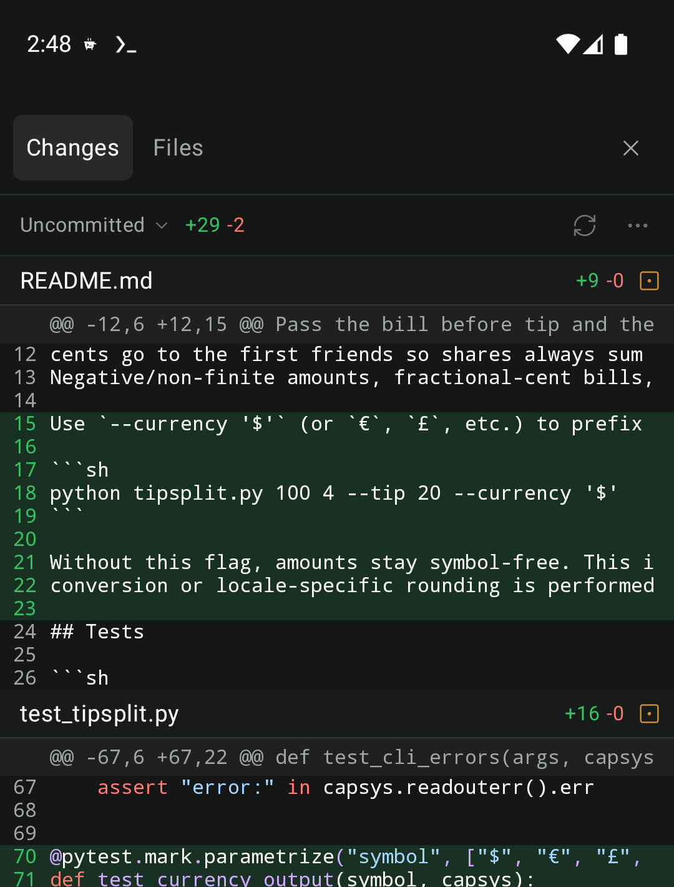
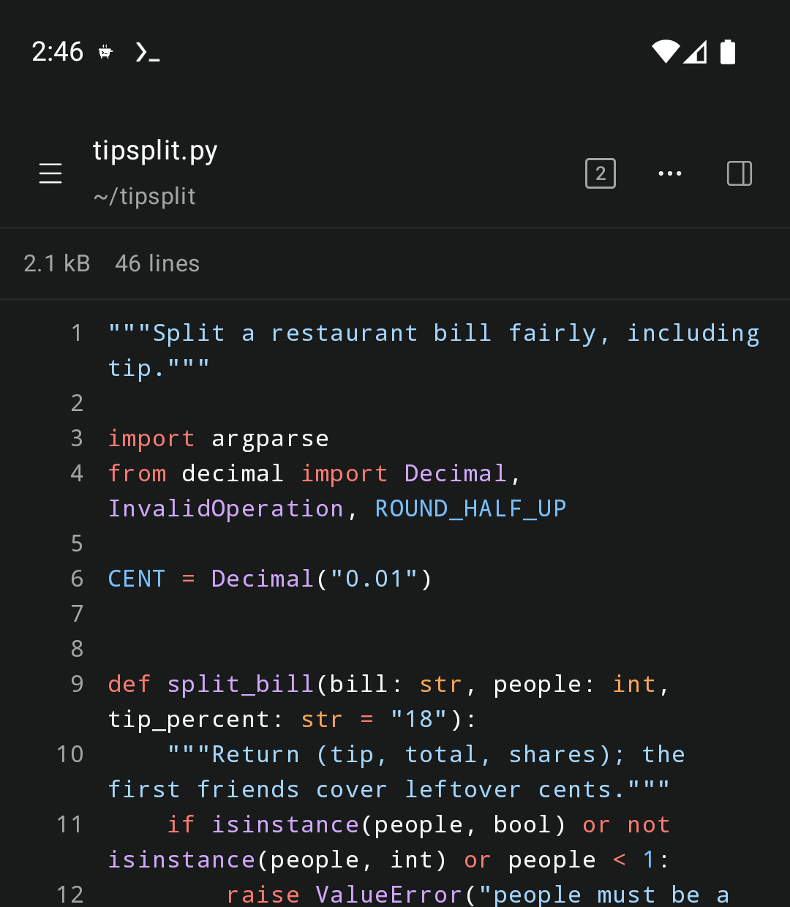

<p align="center">
  
</p>

<h1 align="center">Pipkin</h1>

<p align="center">
  <a href="https://github.com/jeph/pipkin/actions/workflows/release.yml"></a>
  <a href="https://github.com/jeph/pipkin/releases/latest"></a>
  <a href="LICENSE"></a>
</p>

<p align="center">
  <a href="https://pipkin.jeph.io">Website</a> · <a href="https://pipkin.jeph.io/docs/">Docs</a>
</p>

**Pipkin** is a native Android app for agentic coding. Tell it what to build or fix, and it reads your
code, runs commands, edits files, and checks its own work, all on your phone. It's built on the
[Pi](https://pi.dev) agent harness and runs in [Termux](https://termux.dev), so there's no laptop or
cloud server doing the work somewhere else.

<p align="center">
  
  
  
</p>

## Contents

- [Features](#features)
- [Requirements](#requirements)
- [Installation](#installation)
- [Usage](#usage)
- [Development](#development)
- [Contributing](#contributing)
- [License](#license)

## Features

Most agents you use from a phone are remotes for a computer somewhere else. Pipkin runs the agent,
your code, and every command it runs on the phone itself:

- **No computer required.** The agent, your files, git, and terminals all live in Termux on your
  phone. Install compilers, runtimes, and databases with `pkg`, or run Debian or Ubuntu with
  `proot-distro`, no root required.
- **Built on Pi.** Pipkin is compatible with Pi's ecosystem of skills, tools, prompt templates, and
  extensions. Install extensions the usual Pi way and Pipkin picks them up.
- **Native extension UI.** Extensions that use Pi's RPC UI protocol render with native controls:
  choices, confirmations, and text fields appear as cards above the composer, and status lines,
  notices, and widgets each get a home.
- **Android native.** Pipkin is written in Jetpack Compose with no web view, so scrolling, typing, and
  streaming replies stay smooth in long chats. On foldables and tablets, split panes put chats,
  files, diffs, and terminals side by side.
- **A real workbench.** Review changes in the built-in git diff viewer, browse and read files with
  tree-sitter syntax highlighting for more than twenty languages, look back through commits, and
  open terminals without leaving the app.
- **Your model, your plan.** Sign in with a Claude Pro or Max subscription or an OpenAI Codex
  subscription, add a Gemini, Z.ai Coding Plan or Kimi Code API key, or add any OpenAI-compatible
  API, including hosted gateways and servers you run yourself. Add several and switch per chat.
- **Runs in the background.** Lock your phone or switch apps; a notification tells you when the chat
  is done or needs your answer.
- **Guided setup.** A step-by-step guide sets up Termux and installs Pi for you, explaining each
  permission it asks for.
- **Bundled extensions.** Pipkin ships web search and page fetching (a vendored copy of
  [pi-web-access](https://github.com/nicobailon/pi-web-access)) and a to-do list widget.
- **Backups.** Save your settings, sign-ins, models, and extensions in one tap and restore them
  later.

## Requirements

- Android 10 or newer on a 64-bit (arm64 or x86_64) device.
- [Termux](https://termux.dev) from [F-Droid](https://f-droid.org/packages/com.termux/) (0.118 or
  newer, recommended) or [Google Play](https://play.google.com/store/apps/details?id=com.termux)
  (Android 11 or newer).
- A network connection while a chat is working. The agent runs on your phone, but the model runs at
  the provider you connect.

## Installation

### Download a release

[Download the latest APK](https://github.com/jeph/pipkin/releases/latest) from the releases page on
your phone and open it to install. Android asks you to allow installs from your browser or file
manager the first time. Later releases install over it as updates and keep your chats and settings.

Each release also lists the APK's SHA-256 checksum in `SHA256SUMS`, and you can confirm that GitHub
Actions built it from this repository with the [GitHub CLI](https://cli.github.com):

```sh
sha256sum --check SHA256SUMS
gh attestation verify pipkin-v<VERSION>.apk --repo jeph/pipkin
```

### Build from source

The build needs a JDK, the Android SDK, and Node.js and pnpm on your `PATH`; see
[Development](#development) for the exact toolchain.

```sh
git clone https://github.com/jeph/pipkin.git
cd pipkin
./gradlew :app:installDebug
```

`installDebug` installs on the device or emulator that `adb` is connected to. To build an APK
without installing it, run `./gradlew :app:assembleDebug` and find it in
`app/build/outputs/apk/debug/`.

A build from source is signed with your own debug key, not the release key, so Android won't install
it over a downloaded release or the other way around. Uninstall one before installing the other;
uninstalling removes Pipkin's own settings, but your files and chats in Termux stay.

## Usage

The [Pipkin guide](https://pipkin.jeph.io/docs/) covers using the app:

- [Get started](https://pipkin.jeph.io/docs/get-started/): install Termux, walk through setup, and
  start your first chat.
- [Connect a model](https://pipkin.jeph.io/docs/providers/): sign in with a Claude or OpenAI
  subscription, add an API key or an OpenAI-compatible API, and choose models per chat.
- [Configure the agent](https://pipkin.jeph.io/docs/configure/): edit Pi's configuration, give the
  agent standing instructions, and use backups.
- [Extensions](https://pipkin.jeph.io/docs/extensions/): install Pi packages, write your own
  extensions, and add skills and prompt templates.
- [Run in the background](https://pipkin.jeph.io/docs/background/): keep chats and terminal commands
  running when you leave the app or lock the screen.

## Development

Building Pipkin needs:

- A JDK 17 or newer, through `JAVA_HOME` or `java` on your `PATH`, to start Gradle.
- The Android SDK with API level 37, NDK `30.0.16248370`, and CMake `4.1.2`. Point Gradle at the SDK
  with `ANDROID_HOME` or `sdk.dir` in `local.properties`.
- Node.js 22.19 or newer and [pnpm](https://pnpm.io), which build the host bundle.
- A network connection on the first build, which downloads the pinned tree-sitter grammars and the
  JDKs Gradle provisions for itself.

Run every check, including ktlint, detekt, Android lint, and the host's type check, lint, and
tests:

```sh
./gradlew check
```

Run only the host's checks:

```sh
cd host
pnpm install --frozen-lockfile
pnpm run check
```

Run the website locally:

```sh
cd site
pnpm install --frozen-lockfile
pnpm run dev
```

## Contributing

Pull requests are welcome. If you run into a bug, unexpected behavior, or a device-specific
problem, please [open an issue](https://github.com/jeph/pipkin/issues) with your phone model,
Android version, and Termux build. Reports from real-world use are especially helpful while the
project is young.

Do not report suspected security vulnerabilities in public issues. Follow the
[security policy](.github/SECURITY.md) to submit a private vulnerability report.

## License

Pipkin is released under the [MIT License](LICENSE). Third-party code, fonts, and icons that Pipkin
includes keep their own licenses, which are noted in the files they were copied into.
